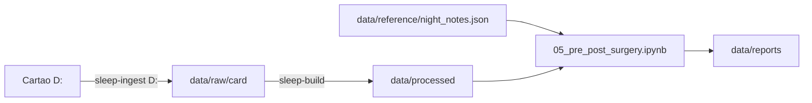

# Comparação pré e pós-cirurgia (pós-operatório inicial)

O cartão em `D:` tem 8 noites que ainda não estão no backup (24 a 30/09 e 14 a 16/10). No pós-cirurgia há 3 noites com uso. Nos dias 28 a 30/09 não houve uso. A pressão caiu de 7,0 para 6,0 cmH2O depois da cirurgia.

Noites com uso perto da cirurgia (números do resumo diário `STR.edf`):

- 27/09, pré: 6,4 h a 7,0 cmH2O, AHI 0,7
- 14/10, pós: 2,6 h a 6,0 cmH2O, AHI 0,0. Uso parcial, com um cochilo às 14:02
- 15/10, pós: 2,5 h a 6,0 cmH2O, AHI 3,5. Uso parcial
- 16/10, pós: 9,4 h a 6,0 cmH2O, AHI 1,0. Noite inteira, primeira com fita na boca

## Decisões confirmadas

- **Recuperação:** a janela de 30 dias continua. As noites de 28/09 a 27/10 recebem o rótulo `recovery`, que o notebook mostra como "pós-operatório inicial". O grupo `after` fica vazio até 28/10.
- **Noites pós:** entram as 3, cada uma anotada (fita na boca, uso parcial, cochilo). As métricas são por hora de uso, e a noite de 16/10 fica em destaque.
- **Linhas de base:** a principal são as últimas 60 noites pré com pelo menos 4 h de uso, todas a 7,0 cmH2O. O controle são as noites pré na mesma pressão: 14 noites a 6,0 (18/11 a 01/12/2025) e 49 a 5,8 (set a nov/2025).



## Etapas

1. **Importação:** rodar `uv run sleep-ingest D:` e depois `uv run sleep-build`. Conferir se `nights` vai até 16/10 e se `sessions`, `signals_2s` e `breaths` têm 14, 15 e 16/10. Apagar o arquivo temporário `C:\Users\lfmou\AppData\Local\Temp\STR_peek.edf`, que foi criado durante a inspeção.
2. **Estudo:** em [config/study.json](config/study.json), preencher `"surgeryDate": "2026-09-28"` e manter `recoveryDaysExcluded: 30`. Em [docs/objectives.md](docs/objectives.md), registrar a cirurgia como feita em 28/09 e a nova pressão de 6,0. Em [docs/architecture.md](docs/architecture.md), documentar o arquivo de notas e as duas linhas de base.
3. **Notas por noite:** criar o arquivo novo [data/reference/night_notes.json](data/reference/night_notes.json). Ele fica fora do git porque `data/` está no `.gitignore`. Formato:

```json
{
  "2026-10-14": { "mouthTape": false, "partial": true, "note": "cochilo 14:02 + início de noite; pós-operatório" },
  "2026-10-15": { "mouthTape": false, "partial": true, "note": "uso parcial; pós-operatório" },
  "2026-10-16": { "mouthTape": true, "partial": false, "note": "primeira noite inteira com fita na boca" }
}
```

   Em [src/sleep_analysis/study.py](src/sleep_analysis/study.py), adicionar `load_night_notes()`, que devolve um DataFrame com as colunas `night`, `mouth_tape`, `partial` e `note` para juntar a `nights`.

4. **Notebook novo:** criar [notebooks/05_pre_post_surgery.ipynb](notebooks/05_pre_post_surgery.ipynb), no mesmo padrão de `01_overview.ipynb` (`connect()`, `load_study()`, `label_period()`):
   - Inventário: tabela com cada noite do pós e o seu contexto (horas, pressão, fita na boca, uso parcial).
   - Tabela de comparação: mediana e intervalo interquartil (IQR) das duas linhas de base contra o valor de cada noite pós. Métricas: `ahi`, `oai`, `cai`, `hi`, `leak_50_l_min`, `leak_95_l_min`, `resp_rate_50`, `tid_vol_50`, `min_vent_50`, `mask_events`.
   - Posição de cada noite pós dentro da distribuição pré (percentil). Com n=3 não há teste de significância.
   - Métricas próprias do fluxo, a partir de `night_metrics` e `respiratory_events` (surges, hypopneia30, eventos parecidos com RERA, despertares), e de `signals_2s` (ronco e limitação de fluxo por hora de uso).
   - Gráficos: a série de AHI e de vazamento com a cirurgia marcada e a janela de recuperação sombreada, e boxplots da linha de base com as noites pós sobrepostas como pontos.
   - Seção de ressalvas: n pequeno, recuperação incompleta, pressão diferente da linha de base principal, fita na boca como variável que confunde o resultado (o vazamento cai por causa dela, não só por causa da cirurgia), e as duas noites parciais.
   - Uma célula final com um placeholder para a comparação definitiva com o grupo `after`, a partir de 28/10.
5. **Execução:** rodar o notebook com `nbconvert --execute` e salvar a saída em `data/reports/05_pre_post_surgery.ipynb`, com as figuras em PNG, como prevê a arquitetura. Resumir os primeiros achados na resposta.
