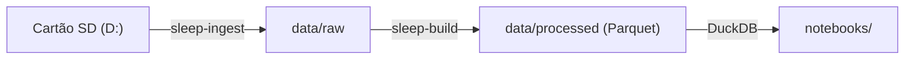

# Arquitetura

Decisão de 23/09/2026: projeto em **Python**, com os dados em arquivos locais e análise em notebooks.

## Por que Python

- Os dados do CPAP são EDF/EDF+ da ResMed, e o ecossistema Python já traz a parte numérica e estatística (numpy, pandas, scipy) de que a comparação antes/depois precisa. Em Node, tanto o leitor quanto a estatística teriam de ser escritos à mão.
- A maior parte do código é SQL (DuckDB) e pandas, próximo do que já faço em JS.
- As tabelas ficam em Parquet, que o Node também lê, então um dashboard em JS continua possível depois.

## Fluxo



| Etapa | Onde | O que faz |
|---|---|---|
| Backup | `src/sleep_analysis/ingest.py` | Cópia incremental do cartão para `data/raw/card` (nada é apagado) e snapshot dos arquivos reescritos em `data/raw/snapshots/<timestamp>` |
| Backup Garmin | `src/sleep_analysis/garmin_sync.py` (`sleep-garmin-sync`) | Busca `dailySleepData` do Garmin Connect para `data/raw/garmin/daily/<calendarDate>.json` (dia em que acordei), relendo os últimos 3 dias; versões reescritas vão para `data/raw/snapshots/<timestamp>/garmin`. Token em `~/.garminconnect`. `--import-dir` copia um export já salvo |
| Conversão | `src/sleep_analysis/build.py` + `edf.py` | Lê os EDF e gera as tabelas Parquet em `data/processed`. Incremental: `data/processed/cache/manifest.json` guarda a impressão digital de cada pasta do DATALOG e o hash do código; só noites alteradas são relidas, e mudança em `respiratory_metrics.py` recalcula só as métricas. `--full` ignora o cache |
| Atualização | `src/sleep_analysis/update.py` (`sleep-update`) + `latest.py` (`sleep-latest`) | Acha o cartão pelo PowerShell, roda ingest, Garmin sem prompt (`--non-interactive`, código 3 sem token) e build, imprime o resumo das últimas noites contra a referência anterior à cirurgia e regenera o relatório comparativo. Fluxo do agente em `.cursor/skills/sleep-data-update/SKILL.md` |
| Relatório comparativo | `src/sleep_analysis/report.py` (`sleep-report`) + `report_template.html` | Página HTML autossuficiente em `data/reports/comparativo.html` (fora do git): antes, recuperação e depois da cirurgia com IC de 90% por bootstrap; indicadores por faixa de pressão e efeito nas trocas; as últimas 90 noites com mediana móvel de 7 noites que recomeça na cirurgia. Usa os grupos de indicadores do `latest.py` |
| Consulta | `src/sleep_analysis/db.py` | DuckDB em memória com as tabelas expostas como views |
| Estudo | `config/study.json` + `study.py` | Data da cirurgia, dias de recuperação excluídos e tamanho da linha de base |
| Contexto por noite | `data/reference/night_notes.json` + `load_night_notes()` | Fita na boca (`mouthTape`), uso parcial (`partial`) e nota livre (`note`), unidos por `night`; arquivo opcional, ausências ficam desconhecidas |
| Análise | `notebooks/` | Exploração e comparações |

## Tabelas

| Tabela | Fonte | Granularidade | Cobertura |
|---|---|---|---|
| `nights` | `STR.edf` | 1 linha por dia de uso | Desde 16/09/2025, inclusive as noites corrompidas no DATALOG |
| `sessions` | `DATALOG/*/*_PLD.edf` | 1 linha por sessão de máscara | Só noites com DATALOG legível |
| `events` | `DATALOG/*/*_EVE.edf` | 1 linha por evento (apneia obstrutiva/central, hipopneia, despertar) | Idem |
| `signals_2s` | `DATALOG/*/*_PLD.edf` | 1 linha a cada 2 s | Idem |
| `breaths` | `DATALOG/*/*_BRP.edf` (fluxo 25 Hz) | 1 linha por respiração | Idem |
| `respiratory_events` | `breaths` | 1 linha por evento inferido (`surge`, `hypopnea30`, `hypopnea50`, `apnea75`, `apnea90`, `rera_like`, `wake_like`) | Idem |
| `night_metrics` | `breaths` | 1 linha por noite; inclui os índices nos cortes de 30%, 40%, 50%, 75% e 90% | Idem |
| `garmin_nights` | `data/raw/garmin/daily` | 1 linha por noite com sono (`night` = calendarDate − 1 dia) | Desde 13/12/2024; dias sem sono ficam de fora |
| `garmin_hr`, `garmin_spo2`, `garmin_hrv` | mesmo JSON | 1 linha por amostra dentro do sono, timestamp em UTC | Detalhe por minuto só a partir de 05/2026 |
| `garmin_stages` | `sleepLevels` | 1 linha por segmento; `activityLevel` 0/1/2/3 = deep/light/rem/awake | Idem |
| `garmin_days` | `data/raw/garmin/stats` | 1 linha por dia civil (passos, intensidade, estresse, FC) | `day` coincide com a noite ResMed que começa naquele fim de tarde |
| `garmin_activities` | `data/raw/garmin/activities` | 1 linha por atividade (tipo, início local e UTC, duração, FC) | Desde 13/12/2024 |

`breaths.py` segmenta o fluxo e `respiratory_metrics.py` detecta os eventos, sempre em relação à linha de base local (mediana das 40 respirações anteriores). `ratios_for_drop` transforma uma queda (0,50 = cai 50%) nos limiares do detector. `notebooks/02_respiratory_validation.ipynb` confere os eventos contra os da ResMed. `rebuild_flow_metrics()` recalcula `night_metrics` e `respiratory_events` a partir dos breaths já segmentados, sem reler o EDF.

`features.py` monta uma linha por noite (`build_night_features`). `undercount.py` casa eventos do aparelho e do fluxo. `reliability.py` dá a nota de cada indicador e o índice. `effects.py` estima o efeito de um fator, com erro de Newey-West, bootstrap em blocos e Benjamini-Hochberg. Hábitos futuros: `config/habits_catalog.json`, `data/reference/daily_log.csv` e `load_daily_log()`.

`notebooks/07_indicator_reliability.ipynb` escolhe o núcleo. `notebooks/08_factor_effects.ipynb` aplica o núcleo a pressão, EPR e umidade. A execução vai para `data/reports/`, com o mesmo `nbconvert` do notebook 05. O ranking que sai dali está em `docs/quality-indicators.md`.

Fica de fora por enquanto:
- **Oximetria (`SAD`):** não há oxímetro conectado, então os valores vêm vazios.

## Decisões

- **Leitor EDF próprio (`edf.py`):** o `pyedflib` recusa o `STR.edf` (unidade "°C" fora do ASCII) e os arquivos EDF+D de eventos.
- **Dados fora do git:** `data/` tem dados de saúde. Notebooks executados devem ser salvos em `data/reports`, não em `notebooks/`.
- **Vazamento em L/min:** a ResMed grava em L/s; a conversão acontece na etapa de build.
- **Dia da ResMed:** vai de meio-dia a meio-dia; a noite de 22/09 inclui a madrugada de 23/09.
- **Comparações justas:** usar a mesma pressão, porque ela variou entre 5,8 e 9 cmH2O ao longo do período.
- **Variáveis do dia a dia (hábitos):** passos, intensidade, estresse e atividades do Garmin entram em `notebooks/06_garmin_correlation.ipynb`. A comparação pré/pós continua sem atribuir causa.
- **Noite Garmin:** `calendarDate` é o dia em que acordei; `night` é o dia anterior, igual ao dia da ResMed. `garmin_days.day` é o dia civil da véspera desse sono.

## Comparação pré/pós-cirurgia

`05_pre_post_surgery.ipynb` usa `connect()`, `load_study()` e `label_period()`.
Cirurgia em 28/09/2026; a recuperação de 30 dias termina em 28/10 (exclusivo).
As três noites de 14–16/10 entram individualmente, inclusive os dois usos
parciais; 16/10 recebe destaque por ser a primeira noite inteira com fita.

- Linha principal: últimas 60 noites pré com uso >= 4 h a 7,0 cmH2O.
- Controle histórico de pressão: noites pré a 6,0 cmH2O; noites a 5,8 são
  mostradas separadamente como sensibilidade, sem misturar pressões.
- Mediana, Q1–Q3 e percentis empíricos por métrica (empates no ponto médio),
  com tamanho de amostra válido por métrica. Sem testes de significância.
- Eventos inferidos são normalizados por hora de uso detalhado das sessões;
  não confundir com os índices de `night_metrics`, cujo denominador é o
  sono estimado pelo algoritmo. Ronco e limitação são minutos positivos
  por hora observada, com cobertura explícita dos sinais e do fluxo.
- Sem detalhe legível, métricas ficam ausentes; zero eventos só é usado
  quando há cobertura e análise válida. Os marcadores de vigília/RERA são
  inferências do fluxo, não despertares ou RERAs confirmados por exame.

O notebook versionado não contém saídas. A execução fica em
`data/reports/05_pre_post_surgery.ipynb`; figuras PNG e tabelas CSV ficam
no mesmo diretório, fora do git. Reexecutar com:

```bash
uv run jupyter nbconvert --execute --to notebook notebooks/05_pre_post_surgery.ipynb --output-dir=data/reports --ExecutePreprocessor.timeout=600
```

`notebooks/06_garmin_correlation.ipynb` cruza o Garmin com o CPAP (pareamento, Spearman a 7,0 cmH2O, noites sem aparelho, FC/SpO2 ao redor dos eventos e hábitos da véspera). A execução vai para `data/reports/06_garmin_correlation.ipynb`, com o mesmo comando e o notebook 06 no lugar do 05.

`notebooks/07_indicator_reliability.ipynb` e `notebooks/08_factor_effects.ipynb` seguem o mesmo comando. O 07 precisa de `night_metrics` já recalculado (`uv run python -c "from sleep_analysis.build import rebuild_flow_metrics; rebuild_flow_metrics()"`).
